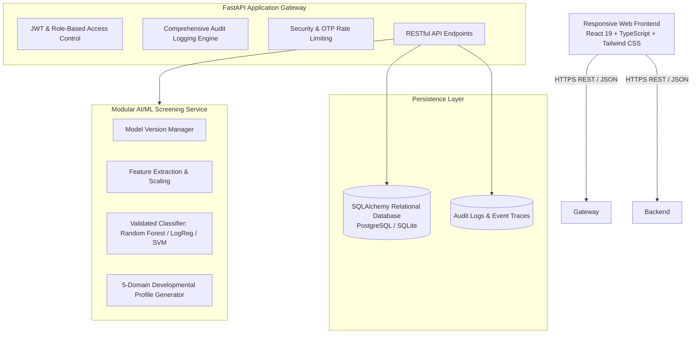

# Auti AIgnosis – System Architecture Document

## 1. System Overview
**Auti AIgnosis** is an AI-assisted autism screening and clinical connection web platform designed to facilitate early screening indications and seamless bridges to licensed clinicians, psychologists, and developmental pediatricians.

> [!IMPORTANT]
> **Clinical Safety & Non-Diagnostic Stance**
> The platform is strictly an **AI-assisted autism screening tool**. It does **not** provide clinical diagnosis. All screening outputs explicitly report developmental indications and recommend clinical consultation with qualified healthcare professionals.

---

## 2. Architectural Topology

---

## 3. Core Modules & Subsystems

### 3.1 Frontend Web Client
- **Framework**: React 19 with TypeScript and Vite.
- **Styling**: Tailwind CSS adhering to a pristine healthcare-grade design system (crisp whites, subtle slate borders `#E2E8F0`, deep teal/cyan primary `#0F766E` / `#0D9488`, accessible typography, status badges, calm and reassuring visual hierarchy).
- **Internationalization (i18n)**: Native client-side dynamic dictionary supporting English (`en`), Kannada (`kn`), and Hindi (`hi`).
- **Responsive Adaptivity**: Mobile bottom navigation bar, tablet dual-column layouts, and desktop clinical workspaces.

### 3.2 Backend RESTful API
- **Framework**: Python 3.13 + FastAPI with Pydantic v2 schemas for strict data contract enforcement.
- **Authentication**:
  - **Patients**: Mobile Number + 6-digit cryptographic OTP flow with expiration, resend lockout, and rate limiting.
  - **Clinicians & Administrators**: Email + Secure Password with salted bcrypt hashing and scoped JWT tokens.
- **Role-Based Access Control (RBAC)**:
  - `patient`: Can only view their own child profiles, screening submissions, and personal appointments.
  - `clinician`: Verified clinical practitioners with access restricted to booked/assigned patients and clinical consultation notes.
  - `admin`: Platform governance, clinician credential verification, audit trace inspection, and user management.

### 3.3 AI/ML Screening Pipeline
- **Methodology**: Based on validated AQ-10 & Q-CHAT behavioral screening paradigms structured across 5 developmental domains:
  1. **Communication**
  2. **Social Interaction**
  3. **Sensory Responses**
  4. **Repetitive Behaviors & Routines**
  5. **Motor & Daily-Life Adaptability**
- **Model Orchestration**: Modular `ModelManager` capable of hot-swapping between trained estimators (Random Forest, Logistic Regression, Decision Tree, Support Vector Machine).
- **Explainability**: Yields calibrated probability scores, sub-domain severity vectors, and transparent contributing factor descriptions.

### 3.4 Clinical Bridge & Appointment Booking
- Verified clinician directory with filters for languages, specialty, and availability slots.
- Concurrency-safe atomic appointment booking preventing double-booking race conditions.
- Structured clinical consultation notes with timestamps and follow-up directives.

---

## 4. Security Architecture
- Parameterized queries through SQLAlchemy preventing SQL Injection.
- Defense against Insecure Direct Object References (IDOR) via strict backend authorization filters.
- Rate-limiting on OTP and authentication routes to thwart brute-force attacks.
- Non-diagnostic clinical safety banners persisted across all screening interfaces.
