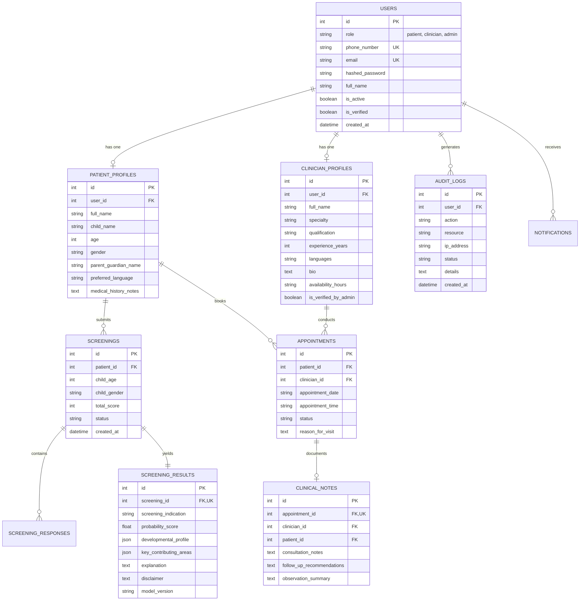

# Auti AIgnosis – Database Architecture & Schema Specification

## 1. Relational Entity Relationship Diagram (ERD)

---

## 2. Indexing & Integrity Strategies
- **Unique Indexes**: `users.phone_number`, `users.email`, `screening_results.screening_id`, `clinical_notes.appointment_id`.
- **Foreign Key Constraints**: All relational cascading rules (`cascade="all, delete-orphan"`) ensure zero orphaned screening responses or dangling patient appointments.
- **Audit Immutability**: `audit_logs` entries cannot be updated once inserted.
