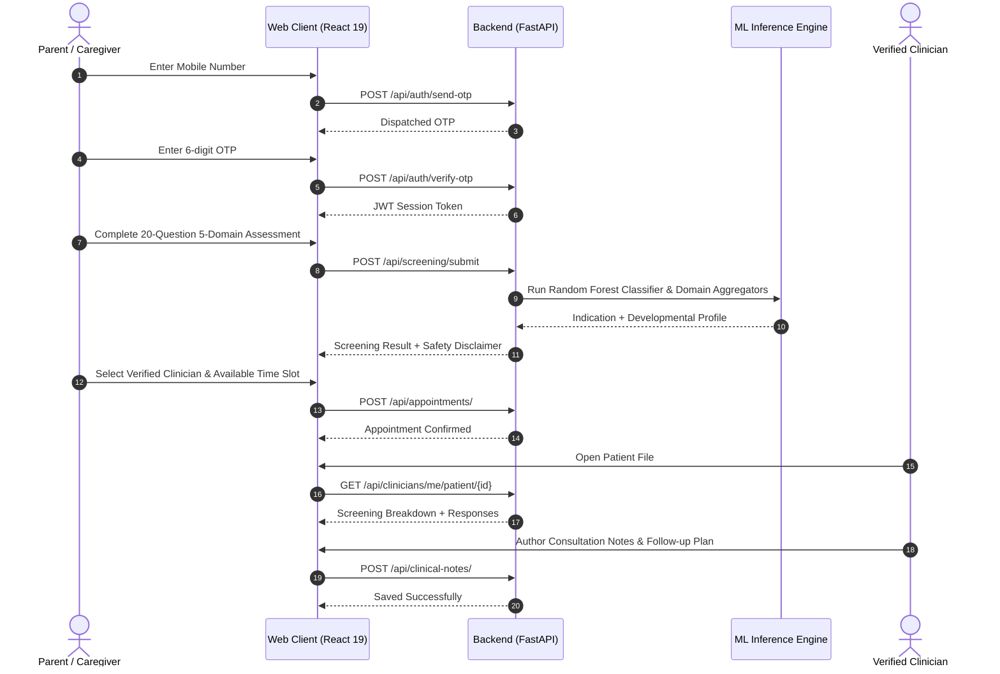

# Auti AIgnosis – Product Requirements Document (PRD)

## 1. Product Vision & Scope
**Auti AIgnosis** is an AI-assisted autism screening and clinical connection web platform designed to streamline early developmental screening indications and provide seamless bridges to licensed clinicians, developmental pediatricians, and child psychologists.

### Core Clinical Safety Boundary
- **Screening Support Only**: Auti AIgnosis is explicitly an AI-assisted behavioral screening tool and **does not diagnose autism**.
- **Mandatory Statutory Notice**: Every screening interface, result report, and clinical handoff displays:
  > *"This screening result is for informational and screening support only. It is not a medical diagnosis. Please consult a qualified clinician for professional evaluation."*

---

## 2. Target Personas & User Roles
1. **Caregivers & Parents (`patient`)**:
   - Access via mobile OTP authentication.
   - Profile management for children (age, gender, developmental notes).
   - Structured 20-item behavioral screening assessment across 5 developmental domains.
   - Instant visual developmental profile feedback and clinical connection.
   - Verified clinician discovery and conflict-free appointment scheduling.
2. **Clinicians (`clinician`)**:
   - Authenticated portal with administrative verification status.
   - Dedicated clinical workspace with patient queue and consultation calendar.
   - Authorized clinical file review (demographics, screening results, 20-question responses, domain vectors).
   - Clinical consultation notes documentation editor with follow-up directives.
3. **Platform Administrators (`admin`)**:
   - Governance dashboard with aggregated screening metrics and appointment trends.
   - Verification queue for clinical practitioners (approve/reject).
   - Account lifecycle controls (activate/deactivate users).
   - Tamper-evident security and audit log inspection.

---

## 3. Product Architecture & User Journey

---

## 4. Key Performance & Quality Metrics
- **Model Performance**: F1-Score $\ge 0.95$ on validated stratified partitions, balancing recall for high-sensitivity screening indications.
- **Latency**: Screening inference execution time $\le 200\text{ ms}$.
- **Accessibility**: Strict high-contrast healthcare design conforming to WCAG 2.1 AA standards.
- **Internationalization**: 100% dictionary coverage for English, Kannada (ಕನ್ನಡ), and Hindi (हिन्दी).
